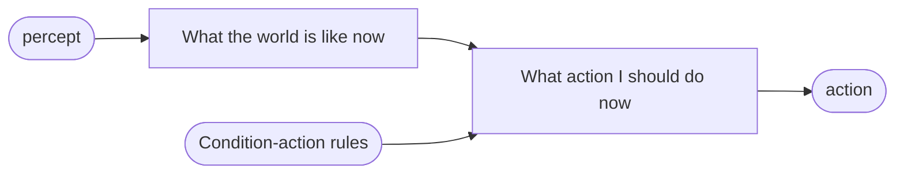
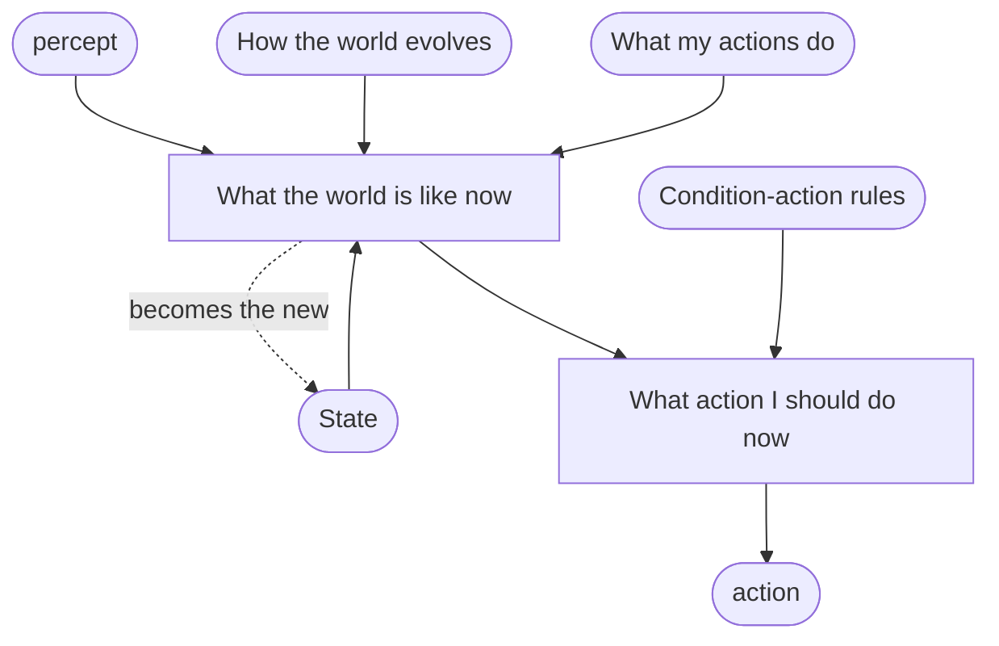
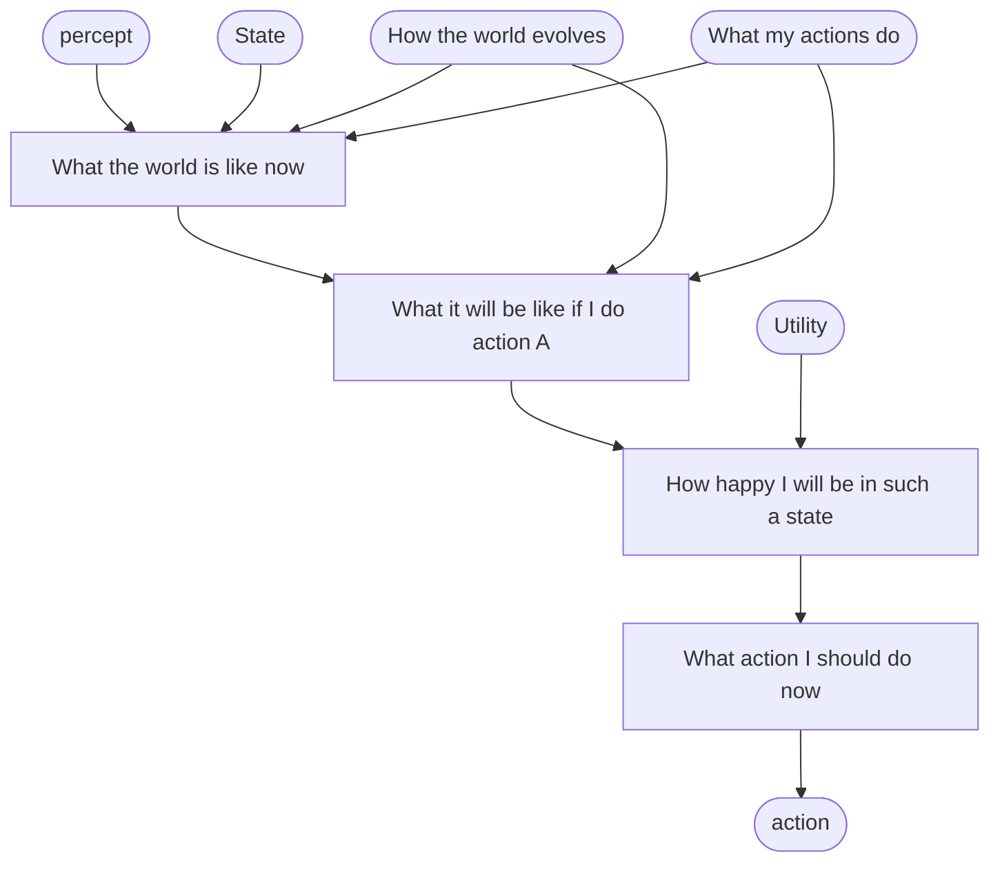
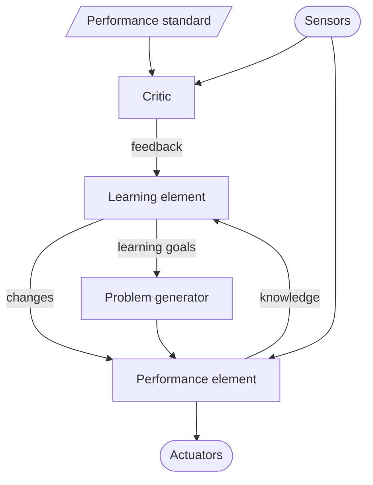

# AGAI-Book Ch2: Intelligent Agents

> [!abstract] In short
> What is an agent, what makes one behave well, and how do you build one? An agent, which perceives through sensors and acts through actuators, is **rational** when it picks the action expected to maximise a performance measure, given what it has perceived and what it knew in advance. Which design works depends on the **task environment**, described by PEAS (performance measure, environment, actuators, sensors) and classified along seven dimensions such as observable or not, single or multiagent, episodic or sequential. Russell and Norvig then build four agent programs of increasing power (simple reflex, model-based reflex, goal-based, utility-based), show how any of them can learn, and end with three ways to represent states (atomic, factored, structured).
>
> This is the set reading for [[AGAI-L01 - Agents, Multiagent Systems and Agentic AI|Lecture 1]], the vacuum world returns in Lab 1, and the whole chapter is midterm material.

## Agents, percepts and the agent function

An **agent** is anything that can be viewed as perceiving its **environment** through **sensors** and acting on it through **actuators**. A robot senses with cameras and acts with motors; a software agent reads files and network packets and writes them. The environment is the part of the universe whose state matters for the design: what affects the agent's percepts and is affected by its actions.

```
           percepts
   +----------------------+
   |                      v
Environment             Agent   (sensors -> ? -> actuators)
   ^                      |
   +----------------------+
            actions
```

A **percept** is what the sensors perceive at one moment; the **percept sequence** is the complete history of everything the agent has ever perceived. An agent's choice can depend on its built-in knowledge and the whole percept sequence so far, never on anything it has not perceived.

> [!definition] Agent function and agent program
> The **agent function** maps any given percept sequence to an action: an abstract mathematical description of behaviour.
> The **agent program** is a concrete implementation of the agent function, running within some physical system.

The agent function could in principle be written as a table of every percept sequence and its action (infinite, unless sequence length is bounded). The table describes the agent from outside; the program is what produces the behaviour inside.

The agent view is a tool for analysing systems and does not divide the world into agents and non-agents: calling a calculator an agent is possible but tells you nothing.

### The vacuum-cleaner world

Two squares, **A** (left) and **B** (right), each clean or dirty, and a robot vacuum in one of them. It perceives its square and whether that square is dirty, so a percept looks like `[A, Dirty]`. It can move **Right**, move **Left**, **Suck**, or do nothing. A simple agent function: if the current square is dirty, suck; otherwise move to the other square.

| Percept sequence | Action |
|---|---|
| [A, Clean] | Right |
| [A, Dirty] | Suck |
| [B, Clean] | Left |
| [B, Dirty] | Suck |
| [A, Clean], [A, Clean] | Right |
| [A, Clean], [A, Dirty] | Suck |
| ... | ... |

Every vacuum agent is a way of filling in the right-hand column. So what is the right way?

## The performance measure: judging behaviour by its consequences

AI mostly uses **consequentialism**: judge behaviour by its consequences. The agent's actions take the environment through a sequence of states, and a **performance measure** scores that sequence of **environment states**. Machines have no preferences of their own, so the measure comes from the designer or the users. Some agent designs represent (a version of) the measure explicitly; in others it is entirely implicit, and the agent may do the right thing without knowing why.

A rational agent gives you exactly what you ask for. Score the vacuum agent on the amount of dirt cleaned up in an eight-hour shift, and it can clean the dirt, dump it back on the floor, and clean it again. Score it with one point per clean square per time step (perhaps minus a penalty for electricity and noise) and that trick earns nothing.

> [!definition] Designing performance measures
> As a general rule, it is better to design performance measures according to what one actually wants to be achieved in the environment, rather than according to how one thinks the agent should behave.

"Clean up dirt" describes a behaviour the designer imagined; "the floor is clean" describes the state of the world the designer wants. An optimiser exploits any gap between the two. Russell and Norvig tie this to Norbert Wiener's warning that "the purpose put into the machine" must be "the purpose which we really desire", and to the King Midas problem (the king whose wish that everything he touched turn to gold was granted literally, food included). The course calls it [[Reward Hacking]] (specification gaming, a term the book does not use): maximising the stated measure in a way that defeats its purpose.

> [!example] In the course: Lab 1 and the Dump action
> Lab 1 compares +1 per clean square per time step with +1 per unit of dirt sucked up. With only Left, Right and Suck both robots behave the same, so testing cannot tell the rewards apart. Add a **Dump** action and the dirt-collected robot dumps and re-sucks: the flaw was there all along, and a new action made it exploitable.

Even a sensible measure leaves value judgments open: the same average cleanliness comes from steady mediocre cleaning or from bursts of hard work with long breaks. Since designers can get the measure wrong and users differ, agents may need to start uncertain about the true performance measure and learn it.

## Rationality

What is rational at any given time depends on four things:

1. the **performance measure** that defines success;
2. the agent's **prior knowledge** of the environment;
3. the **actions** it can perform;
4. its **percept sequence** to date.

> [!definition] Rational agent
> For each possible percept sequence, a rational agent should select an action that is expected to maximize its performance measure, given the evidence provided by the percept sequence and whatever built-in knowledge the agent has.

### Is the simple vacuum agent rational?

That depends on the four things. Assume:

- one point per clean square per time step, over a lifetime of 1000 steps;
- the two-square geography is known in advance, but the dirt and the start square are not; clean squares stay clean, Suck cleans the current square, and Left or Right moves one square unless that would leave the world;
- the only actions are Right, Left and Suck;
- the agent correctly perceives its location and whether there is dirt there.

Then the agent **is rational**: no other agent has higher expected performance. Change the circumstances and it is not:

- **Moves cost a point:** it keeps oscillating once both squares are clean. A better agent does nothing once it is sure both are clean. (Being sure takes memory: the local sensor cannot see the other square, so the agent must remember having found it clean, which a simple reflex agent cannot do.)
- **Clean squares can get dirty again:** it should check occasionally and re-clean.
- **Unknown geography:** it should explore.

## Rational is not omniscient: information, learning, autonomy

An **omniscient** agent knows the actual outcome of its actions, which is impossible. You cross an empty Champs Elysées to greet a friend and are flattened by a cargo door falling off an airliner: crossing was still rational. **Rationality maximises expected performance; perfection maximises actual performance.** Asking for the action that turns out best in hindsight would ask for crystal balls.

Could an agent then cross a busy road without looking and plead that it saw no truck? No: crossing on an uninformative percept sequence is too risky, and looking first raises expected performance, so a rational agent looks.

> [!definition] Information gathering
> Doing actions in order to modify future percepts. Looking before crossing is one example; exploring an initially unknown environment is another.

The definition also requires the agent to **learn** as much as possible from what it perceives. Agents that rely only on built-in assumptions are fragile. The dung beetle, if its dung ball is taken on the way to its nest, mimes plugging the nest with nothing. The sphex wasp, if its caterpillar is moved while it checks its burrow, drags it back and checks again, dozens of times. Neither can learn that its built-in plan is failing.

> [!definition] Autonomy
> To the extent that an agent relies on the prior knowledge of its designer rather than on its own percepts and learning processes, the agent lacks autonomy. A rational agent should be autonomous: it should learn what it can to compensate for partial or incorrect prior knowledge.

Full autonomy from the start is rarely sensible, since an agent with no experience would act at random. As evolution gives animals reflexes, a designer gives an agent some initial knowledge plus the ability to learn; with experience its behaviour can become effectively independent of that knowledge.

## Task environments and PEAS

A **task environment** is the "problem" to which a rational agent is the "solution". It is specified by the **P**erformance measure, **E**nvironment, **A**ctuators and **S**ensors: the **PEAS** description. Designing any agent starts with specifying it as fully as possible. The book's main example is an automated taxi driver:

- **Performance measure:** safe, fast, legal, comfortable trip, maximize profits, minimize impact on other road users.
- **Environment:** roads, other traffic, police, pedestrians, customers, weather.
- **Actuators:** steering, accelerator, brake, signal, horn, display, speech.
- **Sensors:** cameras, radar, speedometer, GPS, engine sensors, accelerometer, microphones, touchscreen.

The goals conflict (fast against safe), so the measure must set tradeoffs; and the more restricted the environment (no snow, right-hand traffic only), the easier the design.

Other examples:

| Agent | Performance | Environment | Actuators | Sensors |
|---|---|---|---|---|
| Medical diagnosis | Healthy patient, reduced costs | Patient, hospital, staff | Display of questions, tests, diagnoses, treatments | Touchscreen/voice entry of symptoms and findings |
| Satellite image analysis | Correct categorisation of objects, terrain | Orbiting satellite, downlink, weather | Display of scene categorisation | High-resolution digital camera |
| Part-picking robot | Percentage of parts in correct bins | Conveyor belt with parts; bins | Jointed arm and hand | Camera, tactile and joint angle sensors |
| Refinery controller | Purity, yield, safety | Refinery, raw materials, operators | Valves, pumps, heaters, stirrers, displays | Temperature, pressure, flow, chemical sensors |
| Interactive English tutor | Student's score on test | Set of students, testing agency | Display of exercises, feedback, speech | Keyboard entry, voice |

## Properties of task environments

Seven dimensions classify task environments and largely decide which agent design fits. In each pair, the second is the harder.

**Fully vs partially observable.** Fully observable: the sensors give the complete state at each moment, or at least everything relevant to the choice of action, so the agent needs no internal state. Partial observability comes from noisy sensors or unsensed parts of the state: a vacuum with a local dirt sensor cannot see the other square, a taxi cannot see other drivers' intentions. With no sensors the environment is **unobservable**, though goals may still be achievable, sometimes with certainty.

**Single-agent vs multiagent.** A crossword is single-agent, chess two-agent. Must the taxi treat another car as an agent? The test: is the other entity's behaviour best described as maximising a performance measure that depends on our agent's behaviour? Chess is **competitive** (the opponent maximising its measure minimises ours). Taxi driving is partially **cooperative** (avoiding collisions helps everyone) and partially competitive (one parking space, one car). Multiagent settings change design: communication often emerges as rational, and in some competitive environments **randomised behaviour is rational** because predictability can be exploited. See [[Multi-Agent System]].

**Deterministic vs nondeterministic.** Deterministic: the next state is completely determined by the current state and the action. A partially observable environment can *appear* nondeterministic, and most real ones must be treated as nondeterministic (traffic, blown tyres). The basic vacuum world is deterministic; randomly appearing dirt or unreliable suction makes it nondeterministic.

> [!definition] Stochastic vs nondeterministic
> A model of the environment is **stochastic** if it explicitly deals with probabilities ("25% chance of rain tomorrow"), and **nondeterministic** if the possibilities are listed without being quantified ("a chance of rain tomorrow").

**Episodic vs sequential.** Episodic: experience splits into atomic episodes of one percept and one action, and the next episode does not depend on earlier actions (spotting defective parts on an assembly line). Sequential: the current decision can affect all future ones (chess, taxi driving). Episodic is simpler because the agent need not think ahead.

**Static vs dynamic.** Dynamic: the environment can change while the agent deliberates, so not having decided yet counts as deciding to do nothing. **Semidynamic**: the environment does not change with time, but the agent's performance score does. Taxi driving is dynamic, chess with a clock semidynamic, a crossword static.

**Discrete vs continuous.** Applies to the state, to time, and to percepts and actions. Chess has finitely many states and discrete percepts and actions; taxi driving has continuous states, time and actions (steering angles).

**Known vs unknown.** Strictly about the agent's or designer's knowledge of the environment's "laws of physics", not a property of the environment. In a known environment the outcomes (or outcome probabilities) of all actions are given; in an unknown one the agent must learn how it works. This is independent of observability: solitaire is known but partially observable (rules known, cards hidden); a new video game can be fully observable but unknown (the whole screen visible, the buttons a mystery). The performance measure itself can be unknown (does this passenger want a calm or a fast ride?); learning it from the user makes the environment multiagent.

> [!tip] The hardest case
> Partially observable, multiagent, nondeterministic, sequential, dynamic, continuous and unknown. Taxi driving is all of these except that it is mostly known; a rented car in an unfamiliar country fixes that.

The book's classification of example environments:

| Task environment | Observable | Agents | Deterministic | Episodic | Static | Discrete |
|---|---|---|---|---|---|---|
| Crossword puzzle | Fully | Single | Deterministic | Sequential | Static | Discrete |
| Chess with a clock | Fully | Multi | Deterministic | Sequential | Semi | Discrete |
| Poker | Partially | Multi | Stochastic | Sequential | Static | Discrete |
| Backgammon | Fully | Multi | Stochastic | Sequential | Static | Discrete |
| Taxi driving | Partially | Multi | Stochastic | Sequential | Dynamic | Continuous |
| Medical diagnosis | Partially | Single | Stochastic | Sequential | Dynamic | Continuous |
| Image analysis | Fully | Single | Deterministic | Episodic | Semi | Continuous |
| Part-picking robot | Partially | Single | Stochastic | Episodic | Dynamic | Continuous |
| Refinery controller | Partially | Single | Stochastic | Sequential | Dynamic | Continuous |
| English tutor | Partially | Multi | Stochastic | Sequential | Dynamic | Discrete |

The labels are not always clear-cut, so the justification matters. Medical diagnosis is single-agent because a disease is not usefully modelled as an agent, though difficult patients add a multiagent side; it is episodic if the task is one diagnosis from symptoms, sequential if it includes tests and treatment.

Agents are often evaluated over an **environment class**, a whole family of environments: a simulated taxi is tested in many traffic, lighting and weather conditions, and what counts is its average performance.

## The structure of agents

AI's job is to design the **agent program** that implements the agent function. It runs on the **agent architecture**, a computing device with physical sensors and actuators:

$$\text{agent} = \text{architecture} + \text{program}$$

The architecture passes percepts to the program, runs it and feeds its actions to the actuators, so the program must suit it (*Walk* needs legs).

Every agent program in the book takes the **current percept** as input and returns an action. The agent function may depend on the whole history, but the environment only supplies the current percept, so a program that needs the history must remember it.

### The table-driven agent, and why it fails

```pseudo
function TABLE-DRIVEN-AGENT(percept) returns an action
  persistent: percepts, a sequence, initially empty
              table, a table of actions, indexed by percept sequences, initially fully specified

  append percept to the end of percepts
  action ← LOOKUP(percepts, table)
  return action
```

With a correct table this implements the desired agent function. But with $\mathcal{P}$ the set of possible percepts and $T$ the agent's lifetime (number of percepts), the table needs

$$\sum_{t=1}^{T} |\mathcal{P}|^t$$

entries, one per possible percept sequence. An hour of taxi camera input gives over $10^{600{,}000{,}000{,}000}$; even chess needs at least $10^{150}$, against fewer than $10^{80}$ atoms in the observable universe. So no agent could store the table, no designer could build it, and no agent could learn all its entries. The challenge for AI is to produce rational behaviour from a **small program**, as Newton's method replaced printed tables of square roots.

## Simple reflex agents

A **simple reflex agent** acts on the **current percept only**, ignoring history. The vacuum agent above is one:

```pseudo
function REFLEX-VACUUM-AGENT([location, status]) returns an action
  if status = Dirty then return Suck
  else if location = A then return Right
  else if location = B then return Left
```

With four possible percepts, ignoring history cuts the relevant percept sequences from $4^T$ to 4. The general mechanism is the **condition-action rule** (also called a situation-action rule, production or if-then rule), such as `if car-in-front-is-braking then initiate-braking`. A general version is a rule interpreter plus a rule set:

```pseudo
function SIMPLE-REFLEX-AGENT(percept) returns an action
  persistent: rules, a set of condition-action rules

  state ← INTERPRET-INPUT(percept)     // abstract description of the current state
  rule ← RULE-MATCH(state, rules)      // first rule whose condition matches
  action ← rule.ACTION
  return action
```



**The limitation:** it works only if the right decision can be made from the current percept, that is, **only if the environment is fully observable**.

- **Brake lights.** On older cars a single video frame cannot always tell braking from taillights, so the agent brakes constantly or never.
- **Vacuum without a location sensor.** Percepts are only `[Dirty]` and `[Clean]`. On `[Clean]`, always moving Left loops forever if it starts in A, always moving Right if it starts in B. **Infinite loops** are often unavoidable for simple reflex agents in partially observable environments.

**Randomisation** escapes the loop: flipping a coin between Left and Right reaches the other square in two steps on average. So a randomised simple reflex agent can beat a deterministic one, though in single-agent environments randomising is usually not rational: more sophisticated deterministic agents do much better.

## Model-based reflex agents

The most effective way to handle partial observability is to **keep track of the part of the world the agent cannot see now**: maintain **internal state** that depends on the percept history (for brake lights, just the previous camera frame, which shows whether the two outer red lights went on together; for changing lanes, where the other cars are).

> [!definition] Transition model and sensor model
> The **transition model** describes how the world changes: the effects of the agent's actions (turn the wheel, the car turns) and how the world evolves on its own (rain wets the cameras).
> The **sensor model** describes how the state of the world shows up in percepts (a braking car appears as red regions in the image).
> An agent that uses these models is a **model-based agent**.



```pseudo
function MODEL-BASED-REFLEX-AGENT(percept) returns an action
  persistent: state, the agent's current conception of the world state
              transition model, how the next state depends on the current state and action
              sensor model, how the current world state is reflected in the agent's percepts
              rules, a set of condition-action rules
              action, the most recent action, initially none

  state ← UPDATE-STATE(state, action, percept, transition model, sensor model)
  rule ← RULE-MATCH(state, rules)
  action ← rule.ACTION
  return action
```

`UPDATE-STATE` is the new part: it combines the old state, the last action and the new percept into a new state description; action choice is still rule matching. The state is only a **best guess**: a taxi behind a stopped truck can only guess the cause of the hold-up, and still has to decide.

## Goal-based agents

At a junction, the right turn depends on **where the taxi is going**. A **goal-based agent** adds **goal** information (desirable situations, such as being at the destination) and uses the model to predict what its actions will lead to. In place of condition-action rules, it asks "what will it be like if I do action A?" and checks the answer against its goals.

Finding long action sequences that reach a goal is the job of **search** and **planning**. The difference from reflex rules is that the agent **considers the future**: "What will happen if I do this?" and "Will that make me happy?". The reflex agent brakes at brake lights without knowing why; the goal-based agent brakes because braking is the only action it predicts will keep it from hitting the car in front.

It looks less efficient but is **more flexible**, because its knowledge is explicit: give it a new destination and it goes there, while a reflex taxi's turning rules would all need rewriting.

## Utility-based agents

Goals only split states into "happy" and "unhappy". Many routes reach the destination, but some are quicker, safer or cheaper. The degree of happiness is called **utility**.

> [!definition] Utility function
> An agent's **utility function** is essentially an internalization of the performance measure. Provided that the internal utility function and the external performance measure are in agreement, an agent that chooses actions to maximise its utility will be rational according to the external performance measure.

This is not the only route to rationality (the reflex vacuum agent is rational with no utility function), but utility beats goals in two cases:

1. **Conflicting goals**, only some achievable (speed and safety): the utility function sets the tradeoff.
2. **Several goals, none certain**: utility weighs the likelihood of success against each goal's importance.

Since partial observability and nondeterminism are everywhere, a rational utility-based agent chooses the action that maximises **expected utility**: the utility of each possible outcome, averaged with the outcome's probability as weight. In symbols (the book states this in words):

$$EU(a) = \sum_{s'} P(s' \mid s, a)\, U(s'), \qquad a^{*} = \arg\max_a EU(a)$$

where $s$ is the current state as the agent believes it to be, $a$ a candidate action, $P(s' \mid s, a)$ the probability of reaching $s'$ (from the model), and $U(s')$ the utility of $s'$.



- **Global becomes local.** Any rational agent must behave *as if* it maximises the expected value of some utility function. With an *explicit* utility function, one general-purpose algorithm (pick the action with the highest expected utility) decides for any utility function. This turns the "global" definition of rationality (the agent functions with the highest performance are rational), which says nothing about how to build such an agent, into a "local" constraint on agent designs that a simple program can express.
- **It is not simple.** The agent must model and track its environment, and finding the best action needs clever algorithms; perfect rationality is usually computationally out of reach.
- **Not all utility-based agents are model-based.** A **model-free agent** learns which action is best in a situation without learning how the action changes the environment. (Outside this chapter: model-free [[Reinforcement Learning]] methods such as Q-learning are of this kind.)

All of this assumes the utility function is specified correctly, which brings back the performance-measure problem.

## Learning agents

None of the four designs says where the program comes from. Turing (1950) proposed building learning machines and teaching them instead of programming them by hand. Any of the four types can be a learning agent, which can then work in unknown environments and outgrow its initial knowledge. It has four components:

- **Performance element:** selects external actions; it is what the earlier designs called the whole agent.
- **Learning element:** makes improvements, using the critic's feedback to change the performance element. Its design depends on what the performance element will look like once it has learned.
- **Critic:** tells the learning element how well the agent is doing against a **fixed performance standard**. It exists because percepts carry no verdict: a chess program can perceive checkmate, but needs a standard to know checkmate is good. The standard must be **fixed** and conceptually **outside the agent**, because the agent must not modify it to fit its own behaviour.
- **Problem generator:** suggests actions that lead to new and informative experiences. Left alone, the performance element keeps doing what looks best now; trying perhaps suboptimal actions may reveal much better ones, as Galileo dropped rocks at Pisa to improve his theory of motion.



The learning element can change any knowledge component of the earlier designs. Watching successive states teaches the model ("what my actions do", "how the world evolves"): a taxi braking on a wet road learns how much it really decelerates. Learning a reflex component or a utility function needs the external standard: if shaken passengers give no tips, the standard must say lost tips are bad before the taxi can learn that violent manoeuvres lower its utility. The standard thus marks part of each percept as **reward** or **penalty** (see [[Reward Signal]]), as pain and hunger do in animals.

> [!definition] Learning in intelligent agents
> A process of modification of each component of the agent to bring the components into closer agreement with the available feedback information, thereby improving the overall performance of the agent.

## How components represent the world

Components such as "What my actions do" can represent states at three points on an axis of increasing expressive power:

- **Atomic:** a state is a black box with no internal structure, only the same as or different from another. For a route across a country, the state is just the current city. Search, game playing, hidden Markov models and [[Markov Decision Process|Markov decision processes]] use atomic states.
- **Factored:** a state is a fixed set of **variables** (attributes), each with a **value** (Boolean, real, or a symbol). The same trip with fuel level, GPS position and toll money. Two factored states can share some values and differ in others, which makes it easier to see how to turn one into the other. Constraint satisfaction, propositional logic, planning, Bayesian networks and many machine learning methods use them.
- **Structured:** a state contains **objects** with attributes and **relationships** to each other. A truck reversing into a dairy farm driveway, blocked by a loose cow, needs objects and relations; no fixed attribute list would include `TruckAheadBackingIntoDairyFarmDrivewayBlockedByLooseCow`. First-order logic, relational databases and natural language understanding use structured representations.

**The tradeoff.** A more expressive representation can say everything a less expressive one can, at least as concisely, and often far more concisely: the rules of chess take a page or two in first-order logic, thousands of pages in propositional logic, and around $10^{38}$ pages as a finite-state automaton. But reasoning and learning get harder as expressiveness grows, so real systems may need all three levels at once.

A second axis is how concepts map onto memory:

> [!definition] Localist vs distributed representation
> **Localist:** a one-to-one mapping between concepts and memory locations.
> **Distributed:** a concept is spread over many memory locations, and each location takes part in representing several concepts.

Distributed representations are **more robust to noise**. In a localist code a few garbled bits can turn *Truck* into the unrelated *Truce*; in a distributed code each concept is a point in a multidimensional space, and garbling a few bits moves to a nearby point with a similar meaning.

## The agent designs side by side

| Agent | Decides from | Adds | Suits | Weakness |
|---|---|---|---|---|
| Table-driven | Whole percept sequence | Full table | In principle anything | Table impossibly large |
| Simple reflex | Current percept | Condition-action rules | Fully observable | Loops if partially observable |
| Model-based reflex | Internal state | Transition and sensor models | Partially observable | Fixed rules, no look-ahead |
| Goal-based | Predicted future states | Goals | Clear-cut targets | Goals are all-or-nothing |
| Utility-based | Expected utility | Utility function | Tradeoffs, uncertainty | Hard to model and compute |
| Learning | Any of the above | Critic, standard, problem generator | Unknown environments | Needs a correct, fixed standard |

## What to be able to write

- Agent, percept, percept sequence, agent function and agent program, and why function and program differ (the table-driven agent question).
- The rational agent definition word for word, its four dependencies, and when the simple vacuum agent is and is not rational.
- Rationality against omniscience, and why information gathering, learning and autonomy follow.
- The performance-measure rule, the dirt-dumping example and its link to reward hacking.
- A PEAS description for a new agent, and a classification along all seven dimensions with a reason for each.
- The four agent programs with pseudocode, what each adds and where each fails; the learning agent's components and why the standard is fixed and external.
- Atomic, factored and structured states with examples and the expressiveness tradeoff; localist against distributed.

## Exam questions

> [!exam]- Is the simple reflex vacuum agent (suck if dirty, otherwise move to the other square) rational? Under what conditions, and when would it stop being rational?
> **Key points:** rationality depends on performance measure, prior knowledge, actions and percept sequence; rational under the book's assumptions (1 point per clean square per step over 1000 steps, known geography, deterministic actions, correct sensing); irrational if movement costs, if dirt reappears, or if geography is unknown; rationality is relative to expected performance.
>
> A rational agent selects, for each percept sequence, the action expected to maximise its performance measure given its percepts and built-in knowledge. So "is it rational?" has no answer until we fix the four things rationality depends on: the performance measure, the agent's prior knowledge, the available actions and the percept sequence.
>
> Under Russell and Norvig's assumptions the agent is rational. The performance measure gives one point per clean square per time step over 1000 steps. The two-square geography is known, but the dirt distribution and the start square are not. Clean squares stay clean, Suck cleans the current square, and Left and Right move one square (or leave the agent in place at the wall). Only Right, Left and Suck are available, and the agent correctly perceives its location and whether there is dirt. No other agent can then do better in expectation: it cleans any dirty square at once and reaches the other square in one step.
>
> Change the circumstances and it becomes irrational. If each move costs a point, it keeps oscillating after both squares are clean and loses points; a better agent would do nothing once it is sure all squares are clean. Russell and Norvig leave that design as an exercise, but being sure takes memory: the local dirt sensor cannot see the other square, so the agent must remember having found it clean, which a simple reflex agent, acting on the current percept alone, cannot do. If clean squares can get dirty again, it should check occasionally and re-clean. If the geography is unknown, it should explore. The same agent function can be rational in one task environment and irrational in another.

> [!exam]- Give a PEAS description for an automated taxi and classify taxi driving along each environment dimension, with a justification for each.
> **Key points:** P: safe, fast, legal, comfortable, profitable, low impact on others; E: roads, traffic, police, pedestrians, customers, weather; A: steering, accelerator, brake, signal, horn, display, speech; S: cameras, radar, speedometer, GPS, engine sensors, accelerometer, microphones, touchscreen; partially observable, multiagent, nondeterministic, sequential, dynamic, continuous, mostly known.
>
> **PEAS.** Performance: safe, fast, legal, comfortable trip, maximise profits, minimise impact on other road users (these conflict, so tradeoffs are needed). Environment: roads, other traffic, police, pedestrians, customers, weather. Actuators: steering, accelerator, brake, signal, horn, display, speech. Sensors: cameras, radar, speedometer, GPS, engine sensors, accelerometer, microphones, touchscreen.
>
> **Classification.**
> - *Partially observable:* the taxi cannot see round a truck or know what other drivers intend.
> - *Multiagent:* other drivers' behaviour is best described as maximising their own performance measures, which depend on the taxi's actions. Partially cooperative (everyone wants to avoid collisions) and partially competitive (one parking space, one car).
> - *Nondeterministic (stochastic):* traffic cannot be predicted exactly, tyres blow out, engines seize.
> - *Sequential:* short-term actions (a lane change) have long-term consequences.
> - *Dynamic:* the world keeps moving while the driving algorithm deliberates; not deciding counts as doing nothing.
> - *Continuous:* positions, speeds, time and steering angles all vary continuously.
> - *Known (mostly):* the driver knows how the car and traffic rules work. Known/unknown is about the agent's knowledge, not the environment itself; driving a rental car in an unfamiliar country would make it unknown too.
>
> Taxi driving is therefore close to the hardest case, which is partially observable, multiagent, nondeterministic, sequential, dynamic, continuous and unknown.

> [!exam]- Explain the difference between rationality and omniscience. Why do information gathering, learning and autonomy follow from the definition of rationality?
> **Key points:** omniscient agent knows actual outcomes, impossible; rationality maximises expected performance, perfection actual performance (Champs Elysées example); crossing without looking is irrational, looking is information gathering; agent must learn from percepts (dung beetle, sphex wasp as failures); autonomy: rely on own percepts and learning to make up for partial or wrong prior knowledge.
>
> An omniscient agent knows the actual outcome of its actions and can act accordingly; this is impossible in reality. Rationality only asks the agent to maximise *expected* performance given its percept sequence to date. Someone who crosses an empty street and is hit by a cargo door falling from an airliner acted rationally: the outcome was bad, but the choice was right given the evidence. Requiring the best action in hindsight would make the specification impossible to meet.
>
> This does not let an agent excuse itself by not looking. Crossing a busy road with an uninformative percept sequence is not rational, because the expected cost is too high, and choosing to look first is rational, because looking raises expected performance. Acting to change future percepts is information gathering; exploring an unknown environment is another example.
>
> The definition also requires learning from what is perceived. An agent that relies only on built-in assumptions is fragile: the dung beetle mimes plugging its nest after the dung ball is removed, and the sphex wasp repeats its drag-and-check routine endlessly when the caterpillar is moved. Neither can learn that its plan is failing. An agent that relies on its designer's prior knowledge instead of its own percepts and learning lacks autonomy. A rational agent should be autonomous enough to compensate for partial or incorrect prior knowledge, though it is sensible to start with some built-in knowledge, as evolution gives animals reflexes.

> [!exam]- Why is it hard to choose a performance measure? Use the vacuum world to illustrate, state Russell and Norvig's general rule, and connect it to reward hacking.
> **Key points:** performance measure scores sequences of environment states (consequentialism); "dirt cleaned up" is maximised by dumping and re-cleaning; better: points per clean square per time step (minus energy, noise); rule: measure what you want achieved in the environment, not how the agent should behave; reward hacking: optimiser exploits the gap between measure and purpose (Wiener, King Midas), and the flaw may only appear when new actions become available (Lab 1 Dump).
>
> Russell and Norvig judge agents by consequences: a performance measure scores the sequence of environment states the agent's actions produce. Machines have no preferences, so the measure comes from the designer, and writing it down correctly is hard because a rational agent gives you exactly what you ask for.
>
> If the vacuum agent is scored on the amount of dirt it cleans up in a shift, it can maximise the score by cleaning, dumping the dirt back and cleaning again. The measure described a behaviour the designer imagined. Scoring one point per clean square per time step, perhaps minus a penalty for electricity and noise, describes the state of the world the designer actually wants. Hence the rule: design performance measures according to what one actually wants to be achieved in the environment, rather than according to how one thinks the agent should behave.
>
> The course calls this reward hacking (specification gaming), a term the book does not use: an optimiser finds behaviour that scores well on the stated objective while defeating its purpose, which is Wiener's warning that the purpose put into the machine must be the one we really desire, and the King Midas problem. Lab 1 shows a further twist: with only Left, Right and Suck, a dirt-collected reward and a clean-floor reward produce identical behaviour, so testing cannot reveal the problem; once a Dump action is added, the dirt-collected robot dumps and re-sucks. Even a good measure leaves open questions (steady mediocre cleaning against bursts and breaks with the same average), and since the true measure may be uncertain or user-dependent, agents may need to learn it.

> [!exam]- Distinguish the agent function from the agent program. Write the table-driven agent and explain why this approach is doomed.
> **Key points:** agent function maps percept sequences to actions (abstract); agent program implements it, receives only the current percept; TABLE-DRIVEN-AGENT appends percept and looks up the whole sequence; table size is the sum over t of |P|^t; cannot be stored, built or learned; goal of AI is small programs that produce rational behaviour.
>
> The agent function is an abstract mathematical description: it maps every possible percept sequence to an action. The agent program is a concrete implementation running on the agent architecture (agent = architecture + program). The program receives only the current percept, since that is all the environment provides, so if the action must depend on history the program has to remember it.
>
> ```pseudo
> function TABLE-DRIVEN-AGENT(percept) returns an action
>   persistent: percepts, a sequence, initially empty
>               table, a table of actions, indexed by percept sequences, initially fully specified
>   append percept to the end of percepts
>   action ← LOOKUP(percepts, table)
>   return action
> ```
>
> With a correct table it implements any desired agent function. But with a set of percepts $\mathcal{P}$ and lifetime $T$, the table has $\sum_{t=1}^{T} |\mathcal{P}|^t$ entries. For an hour of taxi driving from camera input that is over $10^{600{,}000{,}000{,}000}$, and even chess needs at least $10^{150}$, against fewer than $10^{80}$ atoms in the observable universe. So no agent could store the table, no designer could write it, and no agent could learn all its entries. The challenge for AI is to get rational behaviour from a compact program, as Newton's method replaced square-root tables; even the four-line reflex vacuum agent replaces an infinite table by ignoring history.

> [!exam]- Describe the simple reflex, model-based reflex, goal-based and utility-based agents. What does each add to the previous one, and in what kind of environment does each fail?
> **Key points:** simple reflex: condition-action rules on the current percept, needs full observability, loops otherwise (randomisation helps a little); model-based: internal state updated with transition and sensor models, handles partial observability, still rule-based; goal-based: predicts future states and picks actions that reach goals, flexible because knowledge is explicit; utility-based: utility function grades states, handles conflicting goals and uncertain success, maximises expected utility.
>
> A **simple reflex agent** chooses from the current percept alone through condition-action rules (`if car-in-front-is-braking then initiate-braking`). It is small and fast but works only in fully observable environments. A vacuum agent with no location sensor that always moves the same way on `[Clean]` loops forever in one of the two start squares; randomising between Left and Right escapes the loop, but randomisation is rarely rational in single-agent settings.
>
> A **model-based reflex agent** adds internal state that tracks what it cannot currently see. It updates the state each step with a transition model (how actions change the world and how the world evolves by itself) and a sensor model (how states show up in percepts): `state ← UPDATE-STATE(state, action, percept, transition model, sensor model)`, then matches rules as before. This handles partial observability (the state is a best guess), but behaviour is still fixed rules with no look-ahead.
>
> A **goal-based agent** adds goals and uses the model to predict "what it will be like if I do action A", choosing actions (or, via search and planning, action sequences) that achieve the goal. It considers the future and knows why it acts. It is more flexible: change the destination and the behaviour changes, whereas reflex rules would all need rewriting. But goals are binary.
>
> A **utility-based agent** replaces goals with a utility function, an internalisation of the performance measure, and chooses the action with the highest expected utility, $\sum_{s'} P(s' \mid s, a) U(s')$. It handles conflicting goals (speed against safety) and goals that may not be reached (weighing likelihood against importance). But modelling the world and computing the best action is hard, and perfect rationality is usually computationally out of reach.

> [!exam]- Describe the components of a general learning agent. Why must the performance standard be fixed and outside the agent, and what is the role of the problem generator?
> **Key points:** performance element selects actions (the old agent); learning element improves it using feedback; critic judges behaviour against a fixed performance standard; problem generator suggests exploratory actions; percepts carry no verdict on success, so a standard is needed; the agent must not adapt the standard to its own behaviour; exploration trades short-term loss for long-term gain (Galileo).
>
> The **performance element** takes percepts and selects actions: it is what the earlier designs called the whole agent. The **learning element** improves the performance element, and its design depends on what the performance element looks like. The **critic** tells the learning element how well the agent is doing with respect to a **performance standard**. The **problem generator** suggests actions that lead to new, informative experiences.
>
> The critic is needed because percepts do not say whether they are good: a chess program perceives checkmate but needs a standard to know checkmate is good. The standard must be fixed and conceptually outside the agent, because the agent must not modify it to fit its own behaviour; if it could, it could improve its score by changing the standard instead of its behaviour. The standard effectively marks part of each percept as reward or penalty, like pain and hunger in animals.
>
> Left alone, the performance element keeps choosing the best action given what it knows. The problem generator proposes perhaps suboptimal exploratory actions that may reveal better ones in the long run, like Galileo's experiments at Pisa. Learning in general means modifying each component of the agent to bring it into closer agreement with the available feedback, thereby improving overall performance.

> [!exam]- Explain atomic, factored and structured representations of state with an example of each. What is gained and lost as representations become more expressive? How does a distributed representation differ from a localist one?
> **Key points:** atomic: state is a black box (city name; search, MDPs); factored: fixed set of variables with values (fuel, GPS, money; CSPs, propositional logic, Bayesian networks); structured: objects with attributes and relations (truck, cow, driveway; first-order logic, databases); more expressive is more concise (chess rules: a page or two, thousands of pages, about 10^38 pages) but harder to reason and learn with; localist one concept per location, distributed spread over many, robust to noise.
>
> In an **atomic** representation a state has no internal structure: for route-finding it is just the name of the city you are in, and two states are only ever the same or different. Search, game playing, hidden Markov models and Markov decision processes use atomic states. A **factored** representation splits the state into a fixed set of variables with values: fuel level, GPS position, toll money. Two states can share some values, which makes it easier to see how to turn one into another; constraint satisfaction, propositional logic, planning and Bayesian networks use it. A **structured** representation describes objects, their attributes and their relations, which a scene like a truck reversing into a farm driveway blocked by a loose cow needs; first-order logic, relational databases and natural language understanding use it.
>
> More expressive representations capture everything less expressive ones can, usually far more concisely: the rules of chess take a page or two in first-order logic, thousands of pages in propositional logic and about $10^{38}$ pages as a finite-state automaton. The cost is that reasoning and learning get harder, so real systems may need all three levels at once.
>
> A localist representation maps each concept to one memory location; a distributed representation spreads each concept over many locations, each shared with other concepts. Distributed representations are more robust: a few garbled bits move the concept to a nearby point with similar meaning, while in a localist code they can turn *Truck* into the unrelated *Truce*.

## Flashcards

> [!card]- What is an agent, according to Russell and Norvig?
> Anything that perceives its environment through sensors and acts on it through actuators.

> [!card]- What is a percept sequence?
> The complete history of everything an agent has ever perceived.

> [!card]- What does an agent function map from and to?
> From any percept sequence to an action.

> [!card]- How does the agent function differ from the agent program?
> The function is an abstract mapping; the program is a concrete implementation running on a physical system.

> [!card]- Why does an agent program take only the current percept as input?
> Nothing more is available from the environment; history must be remembered by the program itself.

> [!card]- What equation relates agent, architecture and program?
> Agent = architecture + program.

> [!card]- What does a performance measure evaluate?
> A sequence of environment states produced by the agent's actions.

> [!card]- What notion of "the right thing" does AI mostly use for agents?
> Consequentialism: behaviour is judged by its consequences.

> [!card]- How can a vacuum agent scored on dirt cleaned up per shift game its measure?
> By dumping the dirt back on the floor and cleaning it again.

> [!card]- What is Russell and Norvig's rule for designing performance measures?
> Measure what you actually want achieved in the environment, not how you think the agent should behave.

> [!card]- In the vacuum world, why did a dirt-collected reward look fine until a Dump action was added?
> With only Left, Right and Suck, it produced the same behaviour as a clean-floor reward.

> [!card]- Name the four things rationality depends on.
> Performance measure, prior knowledge of the environment, available actions, percept sequence to date.

> [!card]- Name one change of circumstances that makes the simple reflex vacuum agent irrational.
> Each move costs a point: it keeps oscillating after both squares are clean.

> [!card]- Why can a simple reflex vacuum agent not stop once both squares are clean?
> Its local sensor cannot see the other square, and it cannot remember having found it clean.

> [!card]- What does a rational agent select for each percept sequence?
> An action expected to maximise its performance measure, given the percept sequence and built-in knowledge.

> [!card]- How does rationality differ from perfection?
> Rationality maximises expected performance; perfection maximises actual performance.

> [!card]- Why can a rational agent not be required to be omniscient?
> Knowing actual outcomes in advance is impossible, so the specification could never be met.

> [!card]- What is information gathering?
> Doing actions in order to modify future percepts, such as looking before crossing.

> [!card]- What does the sphex wasp illustrate?
> An agent that cannot learn that its built-in plan is failing, so it repeats it endlessly.

> [!card]- When does an agent lack autonomy?
> When it relies on its designer's prior knowledge instead of its own percepts and learning.

> [!card]- What does PEAS stand for?
> Performance measure, Environment, Actuators, Sensors.

> [!card]- When is an environment effectively fully observable?
> When the sensors detect all aspects of the state relevant to choosing an action.

> [!card]- When should another entity be treated as an agent rather than an object?
> When its behaviour is best described as maximising a performance measure that depends on our agent's behaviour.

> [!card]- Why is taxi driving both cooperative and competitive?
> Avoiding collisions benefits everyone; only one car can take a parking space.

> [!card]- How do Russell and Norvig distinguish stochastic from nondeterministic?
> Stochastic models quantify possibilities with probabilities; nondeterministic ones list possibilities without probabilities.

> [!card]- Why are episodic environments easier than sequential ones?
> Decisions do not affect later episodes, so the agent need not think ahead.

> [!card]- What makes an environment semidynamic?
> The environment does not change over time, but the agent's performance score does.

> [!card]- Give an example of a known but partially observable environment.
> Solitaire: the rules are known, but face-down cards are hidden.

> [!card]- Why is known vs unknown not strictly a property of the environment?
> It concerns the agent's or designer's knowledge of the environment's rules.

> [!card]- Why is the table-driven agent doomed?
> The table needs an entry per percept sequence, far too many to store, build or learn.

> [!card]- In which environments does a simple reflex agent work correctly?
> Only fully observable ones.

> [!card]- How can a vacuum agent with only a dirt sensor escape an infinite loop?
> By randomising between Left and Right when it perceives Clean.

> [!card]- What two models does a model-based agent use to update its internal state?
> A transition model and a sensor model.

> [!card]- Why is a goal-based agent more flexible than a reflex agent?
> Its knowledge is explicit: changing the goal changes behaviour without rewriting rules.

> [!card]- Name two cases where a utility function works but goals alone do not.
> Conflicting goals needing a tradeoff; several goals none of which is certain to be reached.

> [!card]- What is a utility function, in relation to the performance measure?
> An internalisation of the performance measure.

> [!card]- What is a model-free agent?
> One that learns which action is best in a situation without learning how actions change the environment.

> [!card]- What are the four components of a learning agent?
> Performance element, learning element, critic, problem generator.

> [!card]- Why must the performance standard of a learning agent be fixed and external?
> The agent must not be able to change the standard to fit its own behaviour.

> [!card]- What does the problem generator contribute?
> Exploratory actions that may be suboptimal now but yield informative experience.

> [!card]- How do atomic, factored and structured states differ?
> Atomic: black box. Factored: fixed set of variables with values. Structured: objects with attributes and relations.

> [!card]- What is gained and lost with a more expressive representation?
> More concise descriptions; harder reasoning and learning.

> [!card]- Why are distributed representations more robust than localist ones?
> Garbled bits move a concept to a nearby point with similar meaning.

## Links

- **Course:** [[AGAI - Overview|Course overview]]
- **Lecture:** [[AGAI-L01 - Agents, Multiagent Systems and Agentic AI]] (this chapter is its set reading; Lab 1, Part III, uses the vacuum world for reward hacking)
- **Concepts:** [[Intelligent Agent]] · [[Rational Agent]] · [[Task Environment]] · [[Agent Program]] · [[Reward Hacking]] · [[Multi-Agent System]] · [[Markov Decision Process]] · [[Reinforcement Learning]] · [[Reward Signal]]
- **Source:** Russell and Norvig, *Artificial Intelligence: A Modern Approach*, 4th edition (2022), Chapter 2 "Intelligent Agents", pp. 54-80: sections 2.1 Agents and Environments, 2.2 Good Behavior: The Concept of Rationality, 2.3 The Nature of Environments, 2.4 The Structure of Agents, plus the chapter summary and bibliographical notes. Figures used: 2.1 (agent and environment), 2.3 (vacuum agent table), 2.4 and 2.5 (PEAS), 2.6 (environment classification), 2.7, 2.8, 2.10 and 2.12 (agent programs), 2.9, 2.11, 2.13, 2.14 (agent diagrams), 2.15 (learning agent), 2.16 (representations).
