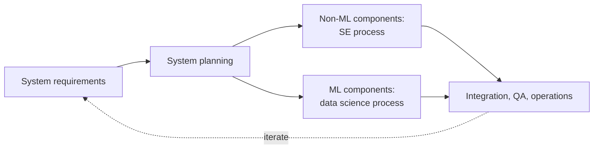

# EPRM-Book Ch20: Data Science and Software Engineering Process Models

> [!abstract] In short
> Data scientists and software engineers both iterate, but for different reasons. Model development is exploratory, like science: you do not know in advance whether a target accuracy is reachable or how long it will take, and many attempts are dead ends. Software engineering has learned that planning before coding pays off, and its process models trade up-front planning against frequent iteration. When the two styles meet in one project they clash over code quality, effort estimates and misunderstandings of what data science involves.
>
> Christian Kästner's answer is an integrated process: plan the system and its components, let each component follow the process that suits it, and iterate at both levels. In practice projects lean **model-first** or **system-first**; each has real benefits and real costs, and neither extreme works on its own.
>
> First chapter of the book part "Process and Teams", assigned in week 1 alongside [[EPRM-Book Ch21 - Interdisciplinary Teams]] and [[EPRM-Book Ch22 - Technical Debt]].

## How data scientists work: iterative and exploratory

In a course, the prediction problem and data are handed to you and the job is high accuracy on held-out data. In production, data scientists also shape the problem, clean data, evaluate model behaviour in more detail, and may shape data collection or deploy and monitor the model.

Model building is usually drawn as a pipeline, but the real process loops back constantly. A data scientist starts with an initial understanding, tries a model with some features, evaluates it, then tries alternatives: more or different data, other cleaning, other features, other model types, other foundation models and prompts, other hyperparameters. Most alternatives are discarded. That is a **science mindset**: start with a goal and explore whether a solution exists and what it looks like, sometimes revisiting the goal itself or the data collection as you learn what the data allows.

The consequence for planning: **progress is unpredictable**. Studies of how data scientists work show quick low-accuracy first models followed by uneven jumps with long flat stretches in between. In one experiment (Patel et al., 2008) participants built handwritten digit recognisers for four hours; their best accuracy rose in irregular jumps, and final accuracies differed widely between people. It is nearly impossible to say up front how long model development will take or what accuracy it will reach.

Other data science process models capture the same loops: **CRISP-DM** (cross-industry standard process for data mining: business understanding, data understanding, data preparation, modelling, evaluation, deployment, arranged in a cycle) and Microsoft's Team Data Science Process. All of them stress that iteration covers goal setting and data understanding too, beyond modelling.

### Notebooks: good for exploration, poor for production

Computational notebooks such as Jupyter interleave code, text and output in cells. Software engineers criticise them for poor practices (no abstraction, global variables, no tests) and for inconsistencies from running cells out of order. But they fit exploration well:

- **Quick feedback** from running small snippets one at a time
- **Incremental computation:** change and rerun one cell without rerunning everything
- **Easy to use:** copying a cell to compare alternatives is quicker than writing a reusable function
- **Visual feedback:** plots and tables appear right in the notebook
- **Shareable:** code, results and documentation together

Kästner's advice: once exploration is finished and the model goes to production, clean the code and move it into a modular, tested, versioned pipeline.

### Different paths through the same steps

A **data-science trajectory** (a term from Martínez-Plumed and coauthors) is the path a project takes through the data science steps. A common split: some projects start from a **clear goal** (a transcription start-up, a cancer prognosis model) and then acquire data for it; others start from **data already available** (a hotel booking company mining customer transactions for better recommendations or marketing stories) and look for opportunities.

## How software engineers work: plan, then iterate

Decades of experience say that jumping straight into code is dangerous: you may solve the wrong problem, pick a design that will never scale, or write code that needs heavy correction. Defects found long after they were introduced cost far more to fix. In data cited in the chapter (Bennett and Wennberg, 2005), a requirements defect costs about 5 times as much to fix during design and about 368 times as much once the system is in operation. So it pays to plan requirements and design before coding, and to budget time for quality assurance and maintenance.

Software processes also include non-coding activities that cost effort now and save more later: design and code review, an issue tracker of known problems, version control, scheduling and monitoring progress, and daily status meetings. Without them, teams slip into "survival mode" when things go wrong: everyone focuses on their own deliverable and neglects integration, which makes things worse.

Process models differ in how they balance planning and iteration:

- **Waterfall:** requirements, architecture, implementation, testing, operations in sequence. Even Royce's original 1970 paper included feedback loops and suggested going through twice (prototype, then real system). Considered too rigid today, but its message "think and plan before coding" lasted.
- **Spiral:** iterate through the waterfall steps repeatedly, building more complete prototypes each round and **tackling the riskiest parts first**, so an infeasible core is discovered before money is spent on the rest.
- **Agile:** requirements are rarely stable or fully known (customers often do not know what they want until they see a prototype), so self-organising teams work closely with customers in short sprints (two weeks to thirty days) with daily standups and replanning after each sprint. Requirements and design work are folded into the cycle, never dropped.

Projects with stable requirements or strict safety or scalability needs (aerospace) lean waterfall; fast-moving products and start-ups chasing a minimum viable product lean agile. Many ML products, with their fast-changing technology, fall in the second group.

## Why the two styles clash

Data science iteration looks like agile or spiral iteration but differs in four ways:

- **Spiral** iteration settles feasibility by doing the risky part first. Model development rarely splits into risky and safe parts, and whether an accuracy level is achievable is often unknown until you try.
- **Agile** iteration responds to vague or changing requirements. In ML the model's goal is often clear and stable; iteration is needed to find out *whether a model can meet it*.
- Software design supports **divide and conquer**, so people can work in parallel. Model development is hard to split into independent subproblems.
- ML iteration is **exploratory, with many dead ends**. In ordinary software, experimentation happens but is rarely the main reason for iterating.

Overall, traditional software has an engineering flavour, with clearer decomposition and a more predictable path; data science has a science flavour, with open problems that may have no feasible solution. Three kinds of conflict follow:

- **Engineering practices.** Engineers complain about data science code, notebooks especially: no abstraction, copy-paste, missing documentation, global state, no tests, poor version control. Kästner's view: in an exploratory phase, abstraction and documentation are of little value and copy-paste and global state are convenient enough. But data scientists should not expect exploratory code to be production-ready.
- **Effort estimation.** Engineers are bad at estimates but improve with experience and methods. Data scientists may have no way to know how long a target accuracy will take, or whether it is reachable at all, which frustrates engineers and managers who do not understand the process.
- **Misunderstanding data science.** Studies find many engineers and managers hold naive views, such as asking for models that never produce false positives. Software engineers who build models without data science training show a strong bias for coding, little appreciation for data exploration and feature engineering, and naivety about overfitting and evaluation. Yang and collaborators observed that when a first model is too weak, such developers rarely explore the data or engineer features, and jump straight to collecting more data or trying deep learning.

## An integrated process for ML-enabled systems

Kästner notes there are no accepted best practices yet. His idealised process: start from **system requirements and system design**, decompose the system into ML and non-ML components with their own requirements, develop each with the process that suits it (software engineering or data science), test components largely independently, then integrate, assure quality and operate. Iteration happens within components and at system level.

Starting at system level frames the component requirements (accuracy, latency, privacy, explainability, fairness), exposes interactions (how the UI affects what data can be collected, how model accuracy affects UI design and safety guardrails) and makes integration and system testing a planned step.

### Model-first versus system-first

Few projects follow the idealised top-down order. The key difference is which comes first, and gets priority.

**Model-first:** data scientists explore existing data or new model capabilities, and only if they find something does the team think about a product around it. Common when the model is the core and the non-ML parts are considered small or less important (a transcription service, whose functionality depends entirely on the model; a demand forecasting system producing daily reports). Usually started by data scientists, with others brought in later.

- *Benefits:* the model is usually the most uncertain part, so testing feasibility first avoids heavy engineering on projects that turn out impossible; data scientists have freedom to explore without system constraints.
- *Costs:* the model often does not fit the system's needs. Many reports describe models abandoned or rebuilt because latency was unacceptable, users would not trust the automation, or explainability or safety requirements had been ignored. User experience suffers. Data scientists often say they could have built a different model had they known the requirements earlier.
- *Advice:* even model-first, do minimal system-level requirements work early, and once feasibility is shown, step back, bring in a broader group of stakeholders and expect the model to change substantially.

**System-first:** a clear product vision exists and the model is planned as one component; about half the projects Kästner's group observed work this way. Common when ML adds a feature to an existing system (audit-risk prediction in tax software) and advisable in regulated domains (banking, hiring) and safety-critical ones (drones, medical software).

- *Benefits:* system-wide planning, better user experience and safety, clearer model requirements (latency, fairness, explainability) so the model fits production.
- *Costs:* the model may turn out infeasible; data scientists have less room to explore; they often receive unrealistic requirements, especially when system designers have made promises to clients.
- *Advice:* involve data scientists and some prototyping early to learn which requirements are realistic.

**Balance.** Neither extreme is practical. Fully parallel development of system and components only works in small teams that iterate and renegotiate interfaces constantly; larger projects need more top-down planning. Either way, deliberately plan for iteration and replanning.

**Examples from the chapter:**

- **Transcription start-up:** model-first, since the model is the riskiest and most business-critical part; take system design seriously once the model works.
- **Hotel recommendation feature:** model-first from logged interaction data, possibly changing the existing site to collect better telemetry, with prototypes integrated without user-visible milestones.
- **Notes app adding LLM summaries:** system-first, since what LLMs can do is roughly known; focus on functionality, presenting results safely (hallucinations), and covering inference costs, with prompt prototyping in parallel.
- **Recidivism risk assessment for judges:** system-first and waterfall-like, because fairness, explainability and regulation must shape data collection and modelling from the start.

## What to be able to do

- Explain why model development is hard to plan, with the digit-recognition experiment as evidence.
- Compare waterfall, spiral and agile, and say how data science iteration differs from each.
- Argue when notebooks are the right tool and when code must move into a tested pipeline.
- Choose model-first or system-first for a given project (including your course project) and name the risks to manage.

## Flashcards

> [!card]- Why is data science model development hard to plan in advance?
> It is exploratory: it is unknown whether a target accuracy is reachable or how long it will take.

> [!card]- What did the four-hour digit-recognition experiment show about model progress?
> Accuracy improved in irregular, unpredictable jumps, and final accuracies differed widely between participants.

> [!card]- What is CRISP-DM?
> A cyclic data mining process: business understanding, data understanding, data preparation, modelling, evaluation, deployment.

> [!card]- Why do notebooks suit exploration?
> Quick feedback, incremental re-execution, easy copying of alternatives, inline plots, code and results shared together.

> [!card]- What should happen to notebook code when a model moves to production?
> Clean it up and migrate it into a modular, tested, versioned pipeline.

> [!card]- What is a data-science trajectory?
> The particular path a project takes through the common data science steps.

> [!card]- Why does software engineering favour planning before coding?
> Defects in requirements and design cost far more to fix the later they are found.

> [!card]- What does the spiral model add to the waterfall model?
> Repeated iterations with growing prototypes, tackling the riskiest parts first.

> [!card]- Why do agile methods iterate?
> Requirements are rarely stable or fully known, so teams replan after short sprints with customers.

> [!card]- How does data science iteration differ from agile iteration?
> Agile iterates to clarify changing requirements; ML iterates to discover whether a model can meet a fairly stable goal.

> [!card]- Why does the spiral model's "risky part first" strategy fit ML poorly?
> Model development rarely splits into risky and safe parts; feasibility of an accuracy target is unclear until tried.

> [!card]- According to Kästner, are copy-paste and global state in exploratory notebooks a problem?
> In exploration they are convenient and sufficient; the code just should not be treated as production-ready.

> [!card]- What do untrained software engineers typically do when their first model is too weak?
> Collect more data or try deep learning, instead of exploring data and engineering features.

> [!card]- What is model-first development?
> Building the model first and designing a system around it once its feasibility is established.

> [!card]- What is the main risk of model-first development?
> The model may not fit system needs, such as latency, trust, explainability or safety, forcing a rebuild.

> [!card]- When is system-first development advisable?
> When adding ML to an existing system, and in regulated or safety-critical domains.

> [!card]- What do data scientists often complain about in system-first projects?
> Unrealistic model requirements, especially after promises made to clients.

## Links

- **Course:** [[EPRM - Overview|Course overview]]
- **Lecture:** [[EPRM-L01 - Data Roles, ML Lifecycle, Clean Code and Unit Testing]] (prototype handovers, notebooks versus production code)
- **Same book part:** [[EPRM-Book Ch21 - Interdisciplinary Teams]] · [[EPRM-Book Ch22 - Technical Debt]]
- **Concepts:** [[MLOps]] · [[Clean Code]]
- **Source:** Christian Kästner, *Machine Learning in Production: From Models to Products* (MIT Press), Chapter 20 "Data Science and Software Engineering Process Models", online edition, https://mlip-cmu.github.io/book/20-data-science-and-software-engineering-process-models.html (CC BY-NC-ND 4.0).
- **Further (cited in the chapter):** Patel, Fogarty, Landay and Harrison, "Investigating Statistical Machine Learning as a Tool for Software Development" (CHI 2008). Royce, "Managing the Development of Large Software Systems" (1970). Boehm, "A Spiral Model of Software Development and Enhancement" (1988). Bennett and Wennberg, "Eliminating Embedded Software Defects Prior to Integration Test" (Crosstalk, 2005).
