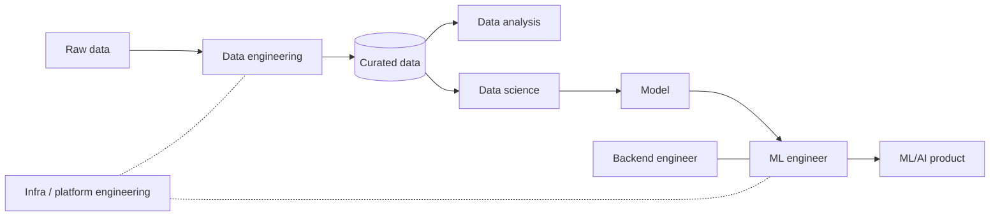
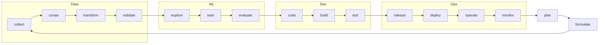

# EPRM-L01: Data Roles, ML Lifecycle, Clean Code and Unit Testing

> [!abstract] In short
> Most ML projects never deliver value, and the usual reasons are people and deployment rather than model quality: the roles involved do not work together, and the model never reaches production. This lecture answers three questions that follow from that.
>
> **Who builds an ML product?** A chain of data roles: data engineers make raw data usable, analysts turn it into information, data scientists build models, ML engineers put models into production and keep them running, with backend and platform teams around them. Handovers along this chain are where projects die, so the lecturer argues for a full-stack ML engineer who owns the problem end to end.
>
> **How does work move to production?** Through layered environments (development, acceptance, production) and the MLOps lifecycle, which joins the data-and-model loop to the DevOps loop.
>
> **What does production-ready code look like?** Clean code that a colleague can read, change and test, plus unit tests that prove each piece does what you think. A z-score with a missing bracket, which runs without error and silently feeds wrong numbers to the model, shows why both matter.
>
> There is no written exam: this feeds Assignment 1, the course project and the TA questioning about your code.

## Why most ML projects never deliver value

The headline number: **87% of ML/AI projects failed** (the course's framing, for 2021). Two causes stand behind it:

- **Roles, individuals and teams could not collaborate**, with each other or with stakeholders.
- **The models could not be deployed.**

The MIT Sloan reading (Davenport and Zhang, 2021) is more precise about the figure. It comes from a VentureBeat analysis suggesting that "87% of AI models are never put into production", so it counts models that never reached production. The article's point is blunt: "If there is no production deployment, there is no economic value." Its advice for data science groups includes partnering with business units that are open to AI, choosing projects with clear value and a clear path to production, getting key stakeholders on board before development starts, and using proofs of concept selectively.

The lecturer, Kemal Yesilbek, adds a slogan from Joshua Seiden's *Outcomes Over Output*: a **brilliant model** is not the goal, a **brilliant outcome** is. The book's subtitle says customer behaviour is the key metric for business success. A model with excellent offline accuracy that sits on a laptop is output; a deployed system that changes what users or the business actually do is an outcome.

Hence this course: ML/AI engineering, which assumes you can build models and teaches you to turn them into live, reliable systems.

## Who does what between raw data and a product

Nobody masters everything ("jack of all trades, master of none"), and the lecturer warns against thinking GenAI can stand in for your own expertise. But once you have enough competence in one field, combining it with a second one pays off, which is where the argument ends up: the full-stack ML engineer.

Every ML role is a **data role**: without data in a usable state there is no ML, and a big part of any data scientist's or ML engineer's job is understanding, cleaning and transforming data. So all data roles have to collaborate for an ML initiative to succeed.

Job titles are a mess (ML engineer, AI engineer, MLOps engineer, ML scientist, prompt engineer and more), with no consensus on what each one does. What stays stable is the skill set, so the course follows the journey from raw data to product and adds one role at each stage.



**Raw data** is data as the backend system saved it, to serve the app's core operations.

### Data engineers: data others can consume

Data engineers build systems so that everyone else can consume data that is:

1. **High quality:** accurate, complete, reliable.
2. **In the right format:** the format serves the purpose.
3. **Available:** it arrives on time, without failures.
4. **Useful:** fit for the purpose it is consumed for.

**The ride-hailing example.** You want the average ride duration per month at a ride-hailing company with no analytics yet. The data was never "collected": it was generated by user interactions and stored by and for the backend. It is low-level events, far from high-level information:

| Event | User | Timestamp |
|---|---|---|
| 0 | U123 | 68323635 |
| 0 | U345 | 6832369D |
| 1 | U123 | 68323636 |
| 0 | U345 | 68323743 |

To get one number you must:

- Work out that events are enumerated to save space: 0 is ride start, 1 is ride end.
- Pair start and end events per user.
- Discover that the timestamp is the hexadecimal form of a UTC Unix epoch (seconds since 1 January 1970) and convert it. Decoded for this note: `0x68323635` is 1,748,121,141, which is 24 May 2025, 21:12:21 UTC.
- Convert the epoch into a date format you can group by month, compute each ride's duration and average per month.

Then the data-quality questions arrive. U123's ride ends one time unit after it starts: is that a real ride? U345 starts a second ride before the first one ended. Some rides have not ended yet. Each needs a decision before the average means anything.

There are also architectural and organisational problems:

- **The database is optimised for the backend.** Your full-history query causes latency spikes in the app, and the app's core operations take priority over analytics.
- **Access rights.** Why do you need this data?
- **Governance and security.** How will you keep the data secure, avoid copies, and honour GDPR's right to be forgotten?

A "simple metric" becomes a project. And the same metric is useful to many teams: reporting, fraud detection (users abusing the system), and ML models that use it as a feature. So it is better if someone produces it once, properly:

| Ride | StartDateTime | Ride duration |
|---|---|---|
| R123 | 24-01-2024 10:53Z | 00:10:05 |
| R234 | 23-06-2024 23:06Z | 00:24:56 |

That is data engineering: double starts handled (quality), hex epochs turned into readable times (format), transformations run on schedule (availability), served to whoever needs it (usefulness), the backend included.

> [!warning] Shift-left reaches everyone
> Data engineers cannot prepare data for every purpose. Expect to extract, transform and load (ETL) data yourself to make it valuable for your ML system. "Shift-left" (moving work earlier in the chain, onto the people building the product) is coming for all of us.

### Data analysts: turning data into information

"Data-driven" means making decisions backed by data instead of only hunches. It is hard: an HBR article reports that only about a quarter of organisations consider themselves data-driven, and executives name culture, a people problem, as the main barrier.

The sharper point is that decision makers need **information**, and getting from data to information is work. **The EV example:** driving an electric car, you must decide whether to stop at the only charging station before your destination. The display shows the battery percentage. That is data, and it does not answer your question. What you need is the estimated remaining range in kilometres, which the car can derive from the data. That is information.

Converting data into information and insight is the analyst's job. Dashboards are one product of it. The core task is to understand the business, the question and the data, calculate the right numbers and present them so the decision is easy. Analysts work closely with the business and tend to specialise in a domain, which makes them good partners at the start of an ML project.

### Data scientists: models that solve a business problem

ML can be **a function of a product** (YouTube Shorts choosing your next video, so well that it becomes addictive, with revenue and ethical concerns rising together) or **the product itself** (Google Translate, ChatGPT).

Building a model that solves the problem is the data scientist's focus. Their tasks:

- Understanding the problem, its scale and impact, and the goal
- Collecting data if it is not available, and understanding it (exploration, cleaning, linking the problem to the data)
- Feature engineering: features with high predictive power that **can also be computed in the live environment** within its non-functional requirements (latency, cost)
- Experiment design, model selection and training, evaluation
- Live (controlled) experimentation: measuring the model's business impact in production
- Monitoring and retraining when performance deteriorates; reporting results

The goal is solving the business problem through ML; models and code are means to that end. So picking the right path matters as much as coding skill.

### ML engineers: production and operations

A beautiful, powerful car without tyres is useless. A model nobody uses has solved nothing.

As companies hired data scientists, many from outside computer science, it became clear that most struggled with software engineering. The early fix was to hand the model to a backend or software engineer to "put it in production". That produced frustrated engineers and, at the extreme, multi-million euro projects that failed completely (the reading on this is Kästner's chapter, see [[EPRM-Book Ch21 - Interdisciplinary Teams]]). ML engineers filled the gap, focusing on two things:

1. **Productionization:** "the process of turning a prototype into a mass-production product", in IT terms bringing it to the live environment. Many data science teams build a prototype that hits the target metric and only then pass it to an ML engineer, who builds the system with or around it.
2. **Operations:** keeping the ML system working as expected in production: **maintenance, monitoring and firefighting**.

### Backend and platform teams

The **backend engineer** works alongside the ML engineer to integrate the model into the product.

**Infrastructure or platform teams** exist because most people prefer cooking to cleaning the kitchen: ML engineers and data scientists would rather build solutions than maintain what sits underneath. Take a database. For a five-person company it takes minutes on a cloud platform. Once many teams use it, someone has to handle scaling, authentication, backups, security, governance (GDPR deletions), access rights, standardisation, duplicated data, wasted resources ("why does this query take 50 GB and five hours?") and the mystery `kemal_table_54456`.

A platform team takes this off the application teams, which does two things:

- It makes the application teams **faster**, because these tasks are no longer theirs.
- It makes the infrastructure **more reliable**, because this is the platform team's expertise.

### The full-stack ML engineer

The lecturer's conclusion from industry: **merge the data scientist and ML engineer roles**. The history explains why.

1. **Early years:** data scientists new to industry. Everything on a laptop, no git, no tests, no deployments, hoping a software engineer deploys it somehow.
2. **Later:** data scientists write some tests. The pain shows (models do not deploy themselves), so the model is passed to a software engineer, who has no idea what ML is.
3. **Later still:** ML engineers are introduced, and the handover problems move to the data scientist and ML engineer boundary.
4. **Now:** full-stack ML engineering is a sought-after skill, and systems get deployed instead of drowning in organisational issues for months or years.

A full-stack ML engineer will not be excellent at everything, but has **adequate skill in every area** (enough to do each part, even at low maturity), so one person can **own the problem and the solution end to end**. In the lecturer's experience, splits and handovers caused trouble and failed projects every time. The course project, an end-to-end system you build yourself, trains this profile.

> [!definition] Full-stack ML engineer
> Combines the data scientist and ML engineer roles: adequate skills across modelling, productionization and operations, so that one person owns the ML problem and its solution end to end, without handovers.

## How ML work moves to production

### Development, acceptance, production

Pressing a button that makes a change live is a bad idea. Modern software processes use **layered environments**:

```
Development  ->  Acceptance            ->  Production
free             integrated services       LIVE, real users
experimentation  and testing               protected
```

- Each environment runs **the same tech stack**, so what works in acceptance works in production.
- **Only production is live**, and production is protected: changes reach it only after passing through the earlier stages.

### The DevOps loop

DevOps (development plus operations) describes software delivery as an endless loop: **plan, code, build, test** on the development side, then **release, deploy, operate, monitor** on the operations side, and what monitoring reveals feeds the next plan. Nothing is ever "done"; it is shipped and watched.

### The model development loop

ML work has its own loop, a data side and a model side:

- **Data:** collect, curate, transform, validate
- **ML:** explore, train, evaluate, formulate

Formulating the problem (what to predict, from what) leads back to collecting the data you need, and exploring the data leads into training.

### MLOps joins the two loops

> [!definition] MLOps
> MLOps = DataML + DevOps. The machine learning lifecycle joins the data-and-model loop to the DevOps loop, so that models are built, shipped, operated and monitored continuously like other software.

In the joined picture (Satish Chandra Gupta's "MLOps eternal knot") the two loops become one continuous cycle. An evaluated model goes into code, build and test; it is released, deployed, operated and monitored; what monitoring shows feeds the plan, which leads to formulating the problem again and collecting new data:



So a trained model is one stage in a cycle that never ends: it is shipped like any software and fed back into data collection and retraining. See [[MLOps]] for the concept in general.

## Clean code: running is not enough

Code that runs is the minimum. Production code is read, changed, debugged and tested by other people, and by you in six months. Bjarne Stroustrup, the inventor of C++, quoted in Robert C. Martin's *Clean Code*: "I like my code to be elegant and efficient. [...] Clean code does one thing well." See [[Clean Code]] for the general concept.

Martin's principles, as the course uses them:

- **Naming:** use intention-revealing names; avoid mental mapping (the reader should not have to translate `d` into "days since signup" in their head). Phil Karlton: "There are only two hard things in Computer Science: cache invalidation and naming things."
- **Functions:** keep them small; each does one thing; no side effects; don't repeat yourself (DRY).
- **Comments:** comments do not make up for bad code. Explain *why*, not *what*. Warn of consequences. Prefer a well-named function or variable to a comment. No commented-out code.
- **Keep it simple:** write for today, not for "what we may need in future". Simple is best and simple is elegant. Do not flex your engineering skills. (The reference here is Brooks's "No Silver Bullet". From outside the course material: it separates the complexity inherent in a problem from the complexity we add with our solutions.)

### Worked examples from the course's `main.py`

The course repository has a small fraud-detection pipeline (`payment_type`, `category`, `amount`, `fraud` columns, a random forest) in a messy `main.py` and a cleaned version. The refactorings, many of them named after smells in Martin's list:

**Separate I/O from transformation.** The original preprocessing function reads the file *and* cleans the data, so it has two reasons to change and cannot be tested without a file on disk.

```python
# before
def data_crunching() -> pd.DataFrame:
    data = read_data(PathsConfig.raw_data)
    data = data.sample(frac=RunConfig.sample_rate)
    data = data.loc[:, ["payment_type", "category", "amount", "fraud"]]
    ...

# after: a pure transformation; main() does the reading
def data_preprocessing(data: pd.DataFrame) -> pd.DataFrame:
    data = data.loc[:, ["payment_type", "category", "amount", "fraud"]]
    data = data.sample(frac=RunConfig.sample_rate)
    ...
```

Note also the rename: "crunching" says nothing; `data_preprocessing` says what happens. The wrapper `read_data(path)`, which only called `pd.read_csv(path)`, was deleted as a **shallow abstraction**: it hides nothing and adds a layer to read through. (A wrapper earns its place when it adds something, such as validation, retries or remote storage.)

**Extract logic so it can be tested, and watch the precedence bug.** The feature function packed a z-score lambda, group-wise z-scores and one-hot encoding into one block:

```python
# before: inside model_preparation()
z_score = lambda x: x["amount"] - x["amount"].mean() / x["amount"].std()

# after: src/features.py
def get_z_score(data: pd.DataFrame) -> pd.Series:
    return (data["amount"] - data["amount"].mean()) / data["amount"].std()
```

Division binds tighter than subtraction, so the original computes $x - \bar{x}/s$ instead of $(x - \bar{x})/s$. For amounts 2, 4, 6 (mean 4, standard deviation 2) the correct z-scores are −1, 0, 1; the buggy line gives 0, 2, 4. **No exception, no crash**: the pipeline finishes and trains on wrong features. Only a unit test with known values catches it, and only once the function is small enough to test on its own. The function was also renamed from `model_preparation` (a model? a train/test split?) to `feature_engineering`.

**Replace magic numbers with named configuration.**

```python
# before
data["is_large_trx"] = (data["amount"] > 123.45).astype(float)

# after
data["is_large_transaction"] = (
    data["amount"] > RunConfig.threshold_in_eur_to_consider_large_transactions
).astype(float)
```

The name says the unit and the meaning, and when risk analysts change the threshold it changes in one place. Hyperparameters go the same way into a model config. The original `RandomForestClassifier(max_depth=1)`, a forest of single-split trees that cannot model interactions such as "high amount and new payment method", was probably a speed setting from early testing that nobody removed. Martin's matching rule: understand the algorithm you use.

**No flag arguments.** A boolean parameter means the function does two things:

```python
# before: two workflows and two return types behind one flag
def model_training(data, is_run_cv: bool = False) -> None:
    ...
    return cv_scores if is_run_cv else model

# after: two methods on a Model class
model.get_cv_scores(data)
model.train_model(data)
```

The before version even claims to return `None` while returning a dict or a classifier, which breaks type hints for every caller.

**Other fixes in the same file:**

- **DRY:** the same eight-line one-hot encoding block was copied for `category` and `payment_type`; it became one `get_encoded_features()` function called in a loop over column names.
- **Names one character apart:** `encoder` (the fitted object) and `encoded` (its output), easy to swap by autocomplete.
- **Truncated names:** `z_scores_by_cat` became `z_scores_by_category`.
- **Obsolete comment:** "Clean the payment type and category by removing the ' characters" above `str.replace("'", "")` repeats the code. The replacement explains why: the CSV encodes strings with quotes.
- **Commented-out code** (`# x = data.drop("amount", axis=1)`) is deleted: git keeps the history.
- **Too many arguments:** `save_model(model, directory, separator, file_name, cv_scores={}, is_s3=False)` became a zero-argument `save_model()` method, with paths from config. The `cv_scores={}` default is a classic Python trap: the dict is created once, when the function is defined, and shared across calls.
- **Global scope:** code written directly under `if __name__ == "__main__":` creates module-level variables (`data`, `model`) that functions in the file can accidentally read or shadow. Wrap it in `def main():` and call `main()`.

> [!warning] Config classes and "frozen"
> The cleaned code keeps its configs in dataclasses marked `frozen=True`. From outside the course material, checked in Python: `frozen` only blocks assignment on *instances* (raising `FrozenInstanceError`); constants used on the class itself, as `RunConfig.x`, can still be reassigned. The config still does its main job, one named place for every constant.

### A good repository layout

The course repository shows what a good layout may look like:

```
uva-mlprod-code/
├── data/  models/  artifacts/     data and trained outputs (model.pkl)
├── infra/                         build (Dockerfile), deployment (yaml),
│                                  telemetry (prometheus, alerts), docker-compose
├── scripts/                       one-off helpers (e.g. csv_to_parquet.py)
├── src/
│   ├── configs/configs.py         every constant and hyperparameter
│   ├── data_processing/           preprocessing
│   ├── feature_engineering/       feature extraction
│   ├── modelling/model.py         the Model class
│   ├── utils/
│   └── main_training.py, main_api.py,
│       main_drift_calculation.py  entry points
├── tests/
│   ├── unit/  integration/  conftest.py
├── Makefile  README.md  requirements.txt  .gitignore  .coveragerc
```

Each folder has one job: pipeline code by stage under `src/`, separate `main_*.py` entry points for training, serving and drift calculation, and tests split into unit and integration.

## Unit testing: proof the code does what you think

More coffee does not mean fewer bugs. How do you know your code works, even on a tired day? You write tests that check it for you, every time. See [[Unit Testing]] for the general concept.

A **unit** is an atomic element of code: a function or a class. Units come in two shapes:

- **Units that perform an action**, like `shutdown()`, which calls `os.system("shutdown")`. The test question: *is the action correct?*
- **Units that return an output from parameters**, like `sum(a, b)`. The test questions: *is the output correct for the given parameters?* and does it hold for both the **happy flow** (normal input) and the **edge cases**? For addition: `1 + 2 == 3` (happy), `-1 + -99999998 == -99999999` (large negatives), and `"a" + 2` should raise an error.

### Dependencies and mocks

Units call other code. An **internal dependency** is your own code. An **external dependency** is something outside your program: a database, a web API, the operating system. A unit test must not hit external dependencies: it would be slow, flaky, and sometimes destructive (nobody wants the test for `shutdown()` to shut down the machine). So you replace the dependency with a **mock**, a stand-in object that records how it was called and returns whatever you tell it to.

```
           External dependency (OS, database, API)
                  ^   replaced by a mock in the test
                  |
params --> [ Software unit ] --> output / action
                  |
           Internal dependency (your own code)
```

### Anatomy of a unit test

Every unit test has three steps:

1. **Setup:** prepare the inputs, the expected results, and mocks for external dependencies.
2. **Collect:** call the unit with the parameters and collect its output (or what it did to the mock).
3. **Compare:** compare the output with the expectations. Pass or fail.

In pytest (written for this note and run with pytest; it is not course code):

```python
from unittest.mock import Mock, patch
import pandas as pd
import pytest
from src.features import get_z_score
from src.ops import add, shutdown          # add(a, b) returns a + b
from src.rates import to_eur               # to_eur(amount, currency, rate_client)

def test_z_score_known_values():
    data = pd.DataFrame({"amount": [2.0, 4.0, 6.0]})            # setup
    expected = pd.Series([-1.0, 0.0, 1.0], name="amount")
    result = get_z_score(data)                                    # collect
    pd.testing.assert_series_equal(result, expected)              # compare

@pytest.mark.parametrize("a, b, expected", [
    (1, 2, 3),                      # happy flow
    (-1, -99999998, -99999999),     # edge case
])
def test_add(a, b, expected):
    assert add(a, b) == expected

def test_add_rejects_str_and_int():
    with pytest.raises(TypeError):
        add("a", 2)

def test_shutdown_calls_the_os():
    with patch("src.ops.os.system") as fake_system:   # setup: mock the OS
        shutdown()                                     # collect
    fake_system.assert_called_once_with("shutdown")    # compare: right action?

def test_to_eur_with_mocked_rate_service():
    rate_client = Mock()                               # external API stand-in
    rate_client.get_rate.return_value = 0.5
    assert to_eur(10.0, "USD", rate_client) == 5.0
    rate_client.get_rate.assert_called_once_with("USD", "EUR")
```

The first test fails on the buggy lambda (it returns 0, 2, 4). The last one tests a function `to_eur(amount, currency, rate_client)` that would normally call a live exchange-rate service; passing the client in as a parameter is what makes it mockable. (The course's example is called `sum`, which shadows Python's built-in `sum`; another naming lesson.) `patch` swaps `os.system` inside `src.ops` for a mock while the `with` block runs, so the test checks the call without shutting anything down.

**Coverage.py** measures which lines your test run executed, which shows the code no test touches.

### Good tests are FIRST

> [!definition] FIRST
> - **Fast:** they run in seconds, so you run them all the time.
> - **Isolated (independent):** no test depends on another or on the order they run in.
> - **Repeatable:** same result on any machine, any time, with no network or shared state.
> - **Self-validating:** they pass or fail on their own; nobody reads output to decide.
> - **Thorough:** they cover the happy flow and the edge cases.

From outside the course: Martin's book spells the last letter as **Timely** (write tests just before the code they test). The course uses Thorough; use the course's version with TAs.

Mocks serve FIRST directly: a mocked API is fast, isolated and repeatable, and the real one is none of those.

## What to be able to do

- Explain where an ML project typically fails (collaboration and deployment) and what "outcome over output" means for your project.
- Describe each data role's job in one or two sentences, and place it on the raw-data-to-product journey.
- Walk through the ride-hailing example: the transformations and data-quality decisions behind one metric.
- Argue for or against a full-stack ML engineer, using the history of handovers.
- Explain development, acceptance and production environments, and draw the DevOps loop, the model development loop and how MLOps joins them.
- Refactor messy pipeline code: separate I/O from pure transformations, name things by intent, extract constants to config, remove flag arguments, duplication, commented-out code and global-scope code.
- Write pytest unit tests with setup, collect and compare steps, parametrised happy-flow and edge cases, an expected exception, and a mock for an external dependency.
- Defend your code to a TA: why each function exists, what each test proves, which FIRST property each test satisfies.

## Flashcards

> [!card]- According to Yesilbek, what are the two main reasons ML/AI projects fail?
> Roles and teams could not collaborate (with each other or stakeholders), and the models could not be deployed.

> [!card]- What does the 87% figure in Davenport and Zhang's MIT Sloan article actually measure?
> A VentureBeat analysis suggesting 87% of AI models are never put into production.

> [!card]- Why does deployment matter so much for return on AI, according to Davenport and Zhang?
> Without production deployment there is no economic value.

> [!card]- What is the difference between a brilliant model and a brilliant outcome?
> The model is output; the outcome is the change in user or business behaviour it actually causes.

> [!card]- Why are all ML roles considered data roles?
> Without data in a usable state there is no ML, so every ML role depends on and works with data.

> [!card]- What four properties should data engineers guarantee for the data they serve?
> High quality, right format, available on time, useful for the purpose.

> [!card]- In the ride-hailing example, what format was the timestamp in?
> The hexadecimal form of a UTC Unix epoch.

> [!card]- Why can't an analyst just run large queries on the backend database?
> It is optimised for backend operations; big queries cause latency spikes, and core operations take priority.

> [!card]- Name three data-quality issues in the ride-hailing event data.
> A near-zero-length ride, a second ride start before the first ended, rides that never ended.

> [!card]- What does "shift-left" mean for an ML engineer's relationship to data engineering?
> Data engineering work moves onto you: expect to do your own ETL for your ML system.

> [!card]- In the EV example, what is the data and what is the information?
> Data: battery percentage. Information: estimated remaining range in kilometres.

> [!card]- What is a data analyst's core task, according to Yesilbek?
> Understanding the business, question and data, and turning data into information for decision makers.

> [!card]- What is the difference between ML as a function of a product and ML as a product?
> Function: ML adds a feature (YouTube Shorts recommendations). Product: the ML system is the product (Google Translate, ChatGPT).

> [!card]- Why must a data scientist's features be computable in the live environment?
> A feature that cannot be computed in production, within latency and cost limits, is useless to the deployed model.

> [!card]- What is the ultimate goal of a data scientist?
> Solving the business problem through ML; models and code are only the means.

> [!card]- What two things does an ML engineer focus on?
> Productionization of ML solutions and operations of ML systems.

> [!card]- What three activities make up ML operations?
> Maintenance, monitoring, firefighting.

> [!card]- Why did handing models to backend engineers go badly?
> Data scientists lacked software engineering skills and the engineers lacked ML knowledge, so nobody owned the whole system.

> [!card]- What two benefits does a platform team bring to application teams?
> Application teams get faster; infrastructure gets more reliable.

> [!card]- Which two roles does a full-stack ML engineer combine?
> Data scientist and ML engineer.

> [!card]- Why does Yesilbek favour full-stack ML engineers over specialised handovers?
> One person owns problem and solution end to end; splits and handovers repeatedly caused project failures.

> [!card]- What makes production different from development and acceptance environments?
> Only production is live, and it is protected; changes reach it after passing the earlier stages.

> [!card]- Why should all environments run the same tech stack?
> So that what passes testing in acceptance behaves the same in production.

> [!card]- Give the steps of the DevOps loop.
> Plan, code, build, test, release, deploy, operate, monitor.

> [!card]- Give the steps of the model development loop.
> Collect, curate, transform, validate (data); explore, train, evaluate, formulate (ML).

> [!card]- In the MLOps eternal knot, how do the Ops steps lead back to the data side?
> Monitoring feeds planning, planning leads to formulating the problem, and formulating leads to collecting new data.

> [!card]- What equation summarises MLOps in Gupta's lifecycle diagrams?
> MLOps = DataML + DevOps.

> [!card]- Why should file reading be kept out of a preprocessing function?
> The function then does one thing and can be unit tested on a small DataFrame without files on disk.

> [!card]- What is a shallow abstraction?
> A wrapper that adds nothing, like a function that only calls pd.read_csv; it just adds indirection.

> [!card]- What does the expression x - mean / std compute, and why is that a dangerous bug?
> x minus (mean/std); it runs without error, so wrong features silently reach the model.

> [!card]- Why are flag arguments a code smell?
> A boolean parameter shows the function does two things, often with two return types.

> [!card]- What should a code comment explain?
> Why the code does something, or a warning of consequences; the code itself shows what.

> [!card]- What should you do with commented-out code?
> Delete it; version control keeps the history.

> [!card]- What are the three steps of a unit test?
> Setup, collect, compare.

> [!card]- Why mock an external dependency in a unit test?
> Real dependencies make tests slow, unrepeatable or destructive; a mock isolates the unit.

> [!card]- What does FIRST stand for in Yesilbek's version?
> Fast, Isolated (independent), Repeatable, Self-validating, Thorough.

## Links

- **Course:** [[EPRM - Overview|Course overview]]
- **Reading note:** [[EPRM-Book Ch21 - Interdisciplinary Teams]] (Kästner on why teams of different roles clash and how DevOps culture helps)
- **Concepts:** [[MLOps]] · [[Clean Code]] · [[Unit Testing]]
- **Source:** lecture slides and speaker notes, "Week 1: Data Driven Roles, ML Lifecycle, and Coding", Kemal T. Yesilbek, 28 October 2026; course intro slides for the framing. Clean code lecture companion "Monolithic vs Clean Refactoring" (instructor-provided, marked AI-generated), mapping `src/main.py` to `src/main_cleaned.py` in `kemalty/uva-mlprod-code`.
- **Readings:** Thomas H. Davenport and Ren Zhang, "Achieving Return on AI Projects", MIT Sloan Management Review, 20 July 2021, https://sloanreview.mit.edu/article/achieving-return-on-ai-projects/ (partly paywalled). Joshua Seiden, *Outcomes Over Output*. Christian Kästner, *Machine Learning in Production: From Models to Products*, part "Process and Teams", https://mlip-cmu.github.io/book/. Robert C. Martin, *Clean Code: A Handbook of Agile Software Craftsmanship* (2008).
- **Further:** HBR, "Why Becoming a Data-Driven Organization Is So Hard" (2022), https://hbr.org/2022/02/why-becoming-a-data-driven-organization-is-so-hard. The DevOps, model development and MLOps lifecycle diagrams are by Satish Chandra Gupta, https://ml4devs.com/mlops-lifecycle. Frederick P. Brooks, "No Silver Bullet: Essence and Accidents of Software Engineering", IEEE Computer 20 (1987).
